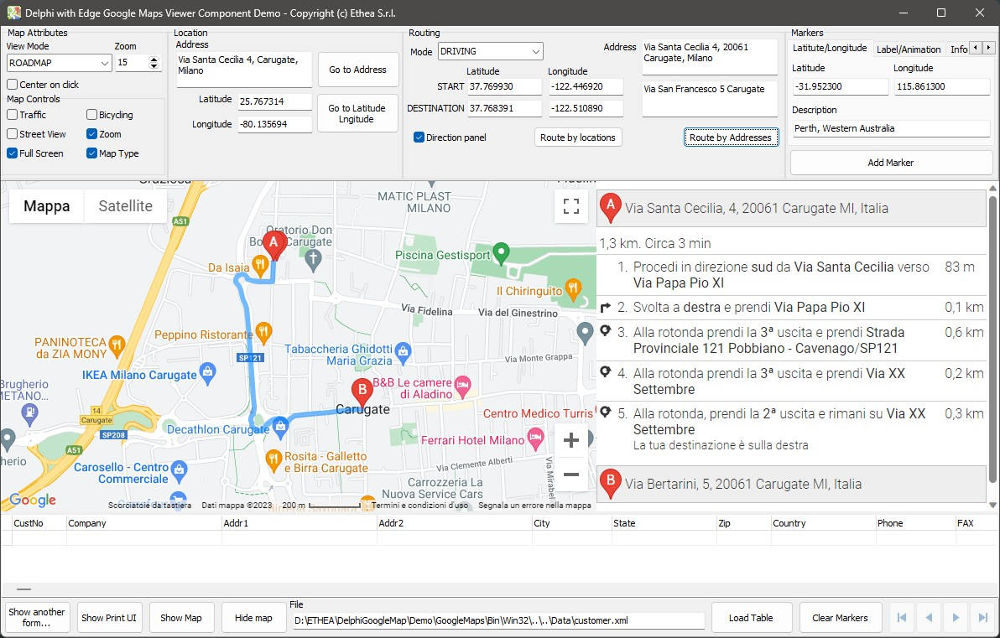

# DelphiGoogleMap

<!-- badges -->
[](LICENSE)
[](https://github.com/EtheaDev/DelphiGoogleMap/releases)
[](https://www.embarcadero.com/products/delphi)
[](https://docwiki.embarcadero.com/RADStudio/en/Main_Page)
[](https://developer.microsoft.com/microsoft-edge/webview2/)
[](https://developers.google.com/maps/documentation/javascript)
[](https://www.microsoft.com/windows)

**TEdgeGoogleMapViewer**: a Delphi "WebView2" Component to View Google Map with integrated Routing and Markers Support

### Actual official version 2.1.0 (VCL)

| Component | Description |
| - | - |
|  | **TEdgeGoogleMapViewer** is a Delphi wrapper on "WebView2" Component that adds many Google Maps features like Routing and Markers Support (only for VCL). You can setup attributes of the components to see the Google Maps reacts to your changes. |

## Installation

Run the [Installer](https://github.com/EtheaDev/DelphiGoogleMap/releases/latest/download/DelphiGoogleMaps_Setup.exe): it detects your Delphi versions, installs the sources, builds and installs the packages and adds the source paths.

Or install the package with [DPM, the Delphi Package Manager](https://delphi.dev/packages/etheadev.delphigooglemap) (Delphi 10.4 to 13, Win32 and Win64), which also copies `WebView2Loader.dll` next to the executable of your project:

```
dpm install EtheaDev.DelphiGoogleMap <path of your project>.dproj
```

Without the installer, open `Packages\<Delphi version>\DelphiGoogleMapsPackages.groupproj`, build the run-time package, build and install the design-time one and add the `Source` folder to the Delphi source path.

If you do not use DPM, `WebView2Loader.dll` (32 or 64 bit) has to be in the same folder as the executable: see `Demo\GoogleMaps\Bin\Win32` and `Win64`.

## Simple to use

You need a [Google Maps API key](https://developers.google.com/maps/documentation/javascript/get-api-key). Register it once, then set properties and call methods:

```pascal
TEdgeGoogleMapViewer.RegisterGoogleMapsApiKey('<your Google Maps API key>');

//Goto Address Example
EdgeGoogleMapViewer.GotoAddress(MemoAddress.Lines.Text);

//Setting Map View Mode
EdgeGoogleMapViewer.MapTypeId := mtHYBRID;

//Route between two addresses, with the directions panel
EdgeGoogleMapViewer.MapShowDirectionsPanel := True;
EdgeGoogleMapViewer.MapStartAddress := 'Via Santa Cecilia 4, Carugate, Milano';
EdgeGoogleMapViewer.MapDestinationAddress := 'Via San Francesco 5, Carugate, Milano';
EdgeGoogleMapViewer.RouteByAddresses;
```



Open `Demo\GoogleMaps\GoogleMapsTest.dproj` to see every feature at work: markers, circles, polylines and polygons, routing, light and dark maps, map events.

## Documentation

Full documentation, with the Quick Start, every feature explained and the walkthrough of the demo, is on the [Project Site](https://ethea.it/docs/delphigooglemap/).

### RELEASE NOTES
07 Nov 2026 - Version 2.1.0
- Fixed CoordToText: longitudes >= 100 lost the last decimals (e.g. 151.209296 became 151.209300)
- Fixed TextToCoord: uses invariant format settings (no uninitialized TFormatSettings fields)
- Fixed texts passed to javascript (addresses, descriptions, labels, info windows): apostrophes, newlines, backslashes and quotes no longer break the script (e.g. "Via dell'Industria"). New class function JSQuotedStr
- Fixed Put* methods and routing called with the map hidden: they now wait until the page and the Google Maps API are loaded (the first overlay or route was lost)
- Fixed OnCreateWebViewCompleted, OnNavigationCompleted and OnWebMessageReceived assigned at design-time: they no longer replace the internal handlers (map never shown, OnMapClick/OnMapZoom/ComputeDistanceBetween not working)
- Fixed PutCircle, PutPolyline and PutPolygon changing the global FormatSettings.DecimalSeparator of the application; opacities keep all the decimals
- Fixed RouteByLocations: points on the Equator or on the Greenwich meridian are valid, an unassigned start point is no longer accepted
- Fixed '%' in the javascript added by OnGetJavascript (e.g. "7 % 2" was truncated)
- Fixed web messages: map events are reported as handled (no more duplicated OnWebUnhandledMessageReceived), memory leaks with non-object JSON messages and COM strings, access violation with messages that are not strings
- Fixed exceptions raised in OnMapClick, OnMapRightClick and OnMapZoom: no longer silently swallowed
- Fixed ComputeDistanceBetween: the 2 seconds timeout is real elapsed time (was about 30 seconds), the map is shown if needed, re-entrant calls are rejected
- Fixed WebView2 initialization failure (e.g. missing WebView2Loader.dll): ShowMap raises the error instead of hanging the application
- Fixed Demo compilation with Delphi 10.4 (Winapi.WebView2 unit not found)
- Added Demo build scripts (Demo\BuildDemo.ps1, BuildAllDemos.ps1, BuildDemoD10.4/D11/D12/D13.ps1)
- Breaking change: OnGetJavascript receives the final javascript (no %s/%d placeholders): write '%' instead of '%%'
- Breaking change: a user OnWebMessageReceived handler is called for every message, in addition to the internal handling

25 Mar 2026 - Version 2.0.0
- Added Support for Delphi 13.1
- Added AdvancedMarkerElement support with automatic fallback to legacy Marker
- Added MapColorScheme property (csLIGHT, csDARK) for light/dark map themes
- Added PutMarker overload with AInfoTitle for InfoWindow header (setHeaderContent API)
- Added PutMarkerByAddress method with geocoding throttling (batch 5, delay 300ms)
- Google Maps API now loaded dynamically with loading=async and callback
- Fixed HideMap to properly clear the map view (navigates to about:blank)
- Updated Demo with Color Scheme selector and "By Address" marker tab

05 Nov 2025 - Version 1.6.4
- Fixed Setup

05 Nov 2025 - Version 1.6.3 (deprecated)
- Added new properties inherited from TEdgeBrowser
- Added new published property MapAPIKey

07 Sep 2025 - Version 1.6.2
- Added support for Delphi 13 - 32 and 64bit IDE
- Updated DelphiGoogleMaps_Setup.exe

12 Mar 2025 - Version 1.6.1
- Added support for Delphi 12 64bit IDE
- Added easy DelphiGoogleMaps_Setup.exe

24 Apr 2024 - Version 1.6.0
- Added functions to add Circles, Polylines or Polygons to map
- Added function ComputeDistanceBetween
- Enabled component into IDE using Win64 Platform

21 Aug 2023 - Version 1.5.0
- Changed Packages: separated Run-Time and Design-Time Packages
- Added "Show Print UI" Panel command
- Added support for Delphi 12

29 Nov 2022 - Version 1.4.0
- FullScreen Control showing switch
- Zoom Control showing switch
- MapType Control showing switch
- Update Demo to implement "fullscreen" request

15 Sep 2022 - Version 1.3.1
- Added 64bit platform to package and demo

09 Apr 2022 - Version 1.3.0
- Fixed problem building package for Delphi 10.4.2

07 Dec 2021 - Version 1.2.0
- Change base object to TCustomEdgeBrowser
- inherit properies to allow the hiding of OnWebMessageReceived and presenting new event OnWebUnhandledMessageReceived
- Map onclick, onzoom listener events
- New property OnMapClick and OnMapRightClick
- Demo to show right click menu and adding a marker
- Demo to have option on center on mouse click
- Demo updated to change zoom edit value on map zoom event
- GotoLocation changed to have option to place marker.

02 Nov 2021 - Version 1.1.0
- Added method to register UserDataFolder: TEdgeGoogleMapViewer.RegisterUserDataFolder
- Added Event Handler BeforeInitMap
- Added a secondary form to Demo (to test multiple instance of component)

24 Sep 2021 - Version 1.0.0
- Google Map Viewer Component based on TEdgeBrowser
- Full Demo available

## License

Copyright (c) 2021-2026 Ethea S.r.l.

Licensed under the [Apache License, Version 2.0](LICENSE) (the "License"): you may not use this software except in compliance with the License. Unless required by applicable law or agreed to in writing, software distributed under the License is distributed on an "AS IS" BASIS, WITHOUT WARRANTIES OR CONDITIONS OF ANY KIND, either express or implied. See the License for the specific language governing permissions and limitations under the License.
